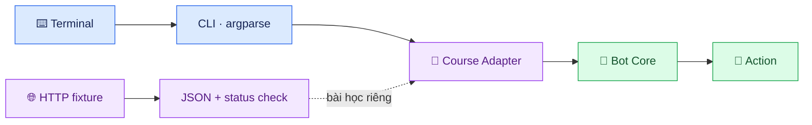

# 🐸 Week 13 — Modules, CLI & HTTP

<p align="center">
  <strong>From one Python file to a small, well-organized program.</strong><br>
  Tách trách nhiệm · Nhận lệnh từ terminal · Hiểu dữ liệu HTTP · Kiểm chứng bằng test
</p>

<p align="center">
  
  
  
  
</p>

<p align="center">
  <em>Read → Import → Run → Inspect → Test → Explain</em>
</p>

---

## 🚀 Nhiệm vụ tuần này

Tuần 13 là bước chuyển từ **“viết được một hàm”** sang **“biết tổ chức một chương trình nhỏ”**. Ta theo chân một bot học tập để khám phá cách các phần phối hợp — mà không biến mọi thứ thành một file dài khó sửa.

<table>
  <tr>
    <td align="center" width="25%">
      <h3>🧠 Core</h3>
      Quyết định hành động
    </td>
    <td align="center" width="25%">
      <h3>🔌 Adapter</h3>
      Chuyển đổi dữ liệu
    </td>
    <td align="center" width="25%">
      <h3>⌨️ CLI</h3>
      Nhận lệnh từ bạn
    </td>
    <td align="center" width="25%">
      <h3>🌐 HTTP</h3>
      Hiểu request/response
    </td>
  </tr>
</table>

### 🗺️ Nhìn nhanh kiến trúc



> 💡 **Ý tưởng cốt lõi:** Core lo việc ra quyết định; CLI lo nhận lệnh; Adapter lo chuyển đổi dữ liệu. Khi mỗi phần có một nhiệm vụ rõ ràng, chương trình dễ hiểu, dễ test và dễ thay đổi hơn.

---

## 🎯 Sau tuần này, bạn sẽ có thể

- [ ] 📦 Import module và hiểu package, `__init__.py`.
- [ ] 🚦 Dùng `if __name__ == "__main__":` để kiểm soát điểm bắt đầu.
- [ ] 🧪 Hiểu vai trò của `venv`, `python -m pip` và `pyproject.toml`.
- [ ] ⌨️ Tạo tham số CLI bằng `argparse`, đặt kiểu dữ liệu và yêu cầu bắt buộc.
- [ ] 🌐 Nhận biết HTTP method, status code, response body và JSON.
- [ ] 🛡️ Hiểu vì sao status thành công chưa chắc body hợp lệ.
- [ ] 🧱 Giải thích vì sao Bot Core nên độc lập với CLI và network.
- [ ] ✅ Chạy self-check để kiểm tra hành vi thay vì chỉ nhìn output.

## 🧭 Hành trình thực hành

Đi lần lượt theo các chặng dưới đây. Nếu gặp khó, hãy thử tự làm trước rồi mới mở hints.

<details open>
  <summary><strong>🟢 Chặng 1 — Đọc bản đồ</strong></summary>

  Đọc [Notes](notes.md) để nắm module, package, CLI và HTTP. Chú ý ranh giới giữa Core và phần giao tiếp bên ngoài.
</details>

<details>
  <summary><strong>🔵 Chặng 2 — Thử từng kỹ năng</strong></summary>

  - [Exercises README](exercises/README.md)
  - Exercise 01: import và main guard
  - Exercise 02: thêm tham số `--turn`
  - Exercise 03: parse JSON fixture và xử lý status lỗi
</details>

<details>
  <summary><strong>🟣 Chặng 3 — Kết nối các phần</strong></summary>

  Làm theo [Mini-project](mini-project/README.md): xem dữ liệu đi từ CLI qua Adapter đến Bot Core.
</details>

<details>
  <summary><strong>🟠 Chặng 4 — Tự kiểm chứng</strong></summary>

  Chạy self-check bên dưới. Nếu chưa qua, đọc lỗi đầu tiên, xác định phần gây lỗi rồi mới sửa.
</details>

---

## ⚡ Chạy thử trong terminal

> Các lệnh đầu tiên chạy từ **thư mục gốc repository**.

### 1. Khởi động bot

```bash
python weeks/week-13-modules-cli-api/cli.py --position 1 --goal 4
```

Vì vị trí `1` nhỏ hơn mục tiêu `4`, Core chọn hành động `right`. Output được đóng gói theo định dạng course adapter để phục vụ bài học.

### 2. Chạy ba exercise

Chuyển vào thư mục tuần:

```bash
cd weeks/week-13-modules-cli-api
python -m exercises.ex01_modules
python -m exercises.ex02_cli --turn 3
python -m exercises.ex03_http
```

Exercise 02 dự kiến in:

```text
Namespace(turn=3)
```

Dùng `python -m exercises.<module>` để chạy module trong ngữ cảnh package. Chạy file trực tiếp bằng đường dẫn có thể khiến cách Python tìm module khác đi.

### 3. Chạy self-check

Quay lại thư mục gốc repository, rồi chạy:

```bash
python weeks/week-13-modules-cli-api/checks/check_week.py
```

Khi các kiểm tra đều qua, kết quả mong đợi là:

```text
Week 13 solution checks: PASS
```

<details>
  <summary><strong>🧯 Nếu lệnh báo lỗi thì kiểm tra gì?</strong></summary>

  1. Bạn đang ở đúng thư mục chưa?
  2. Tên file và tên module đã gõ chính xác chưa?
  3. Bạn đang dùng đúng Python interpreter không?
  4. Bạn đã lưu file sau khi sửa chưa?

  Hãy đọc dòng lỗi đầu tiên có ý nghĩa trước khi cài thêm thư viện.
</details>

---

## 🔬 Ba phát hiện quan trọng

<table>
  <tr>
    <td width="33%">
      <h3>📦 01 · Module</h3>
      File Python có thể được import để tái sử dụng. Main guard phân biệt việc import với việc chạy chương trình.
    </td>
    <td width="33%">
      <h3>⌨️ 02 · CLI</h3>
      <code>argparse</code> biến tham số terminal thành giá trị có tên và kiểu dữ liệu. CLI không nên chứa toàn bộ logic nghiệp vụ.
    </td>
    <td width="33%">
      <h3>🌐 03 · HTTP</h3>
      Kiểm tra status và parse JSON là hai việc riêng. Body vẫn có thể sai dù status thuộc nhóm thành công.
    </td>
  </tr>
</table>

### 🧱 Ai chịu trách nhiệm việc gì?

| Thành phần | Trách nhiệm | Không nên làm |
|---|---|---|
| **Bot Core** | Quyết định từ dữ liệu đầu vào | Đọc `sys.argv` hoặc tự gọi mạng |
| **Adapter** | Chuyển đổi và đóng gói dữ liệu | Giả vờ là giao thức production đã xác minh |
| **CLI** | Nhận tham số và gọi phần phù hợp | Nhét mọi logic quyết định vào CLI |
| **HTTP foundation** | Minh họa request, status và JSON | Suy diễn endpoint thật từ dữ liệu mẫu |

> 🔒 **Ranh giới an toàn:** ví dụ HTTP của tuần này dùng fixture offline. Endpoint, authentication, schema và runtime contract của VuaCóc production **chưa được xác minh**; không suy đoán chúng từ bài học.

---

## 🧰 Môi trường Python

Từ thư mục tuần, tạo virtual environment:

```bash
python -m venv .venv
```

Sau đó kích hoạt môi trường theo hệ điều hành của bạn và dùng `python -m pip` để cài thư viện vào đúng interpreter. Xem `pyproject.toml` và [Notes](notes.md) để biết dependency/tooling được khai báo. Chỉ cài nhóm dev khi bạn cần các công cụ phát triển tương ứng.

---

## 📚 Tài liệu cần thiết

| Tài liệu | Dùng khi nào? |
|---|---|
| [📖 Notes](notes.md) | Muốn hiểu khái niệm |
| [🧩 Exercises](exercises/README.md) | Muốn tự code từng phần |
| [💡 Hints](hints.md) | Đã thử nhưng đang mắc |
| [📦 Bot Core](bot_course/) | Muốn xem module trong package |
| [🐸 Mini-project](mini-project/README.md) | Muốn xem các phần nối với nhau |

---

## 🏁 Boss fight — tự trả lời trước khi sang Week 14

Không nhìn code, thử giải thích bằng lời của bạn:

1. Module khác package ở điểm nào?
2. Vì sao import một file không nên tự động chạy CLI?
3. `type=int` trong `argparse` có tác dụng gì?
4. Vì sao cần kiểm tra status code và JSON body riêng?
5. Vì sao Core không nên phụ thuộc vào CLI hoặc network?

**Bạn đã qua màn khi:** chạy được chương trình, self-check thành công và giải thích được đường đi của dữ liệu.

<p align="center">
  <strong>✨ Keep the core small. Make the boundaries clear. Prove it with tests. ✨</strong><br>
  <sub>Python Journey · Week 13</sub>
</p>
